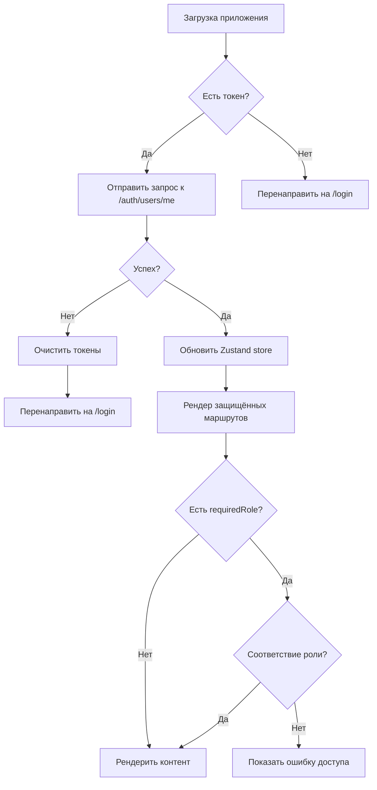

# PicNest - Модуль Аутентификации и Защиты Маршрутов

Полная документация по системе аутентификации и контроля доступа в проекте PicNest.

## 📦 Структура проекта

```
src/
├── lib/
│   └── axios.ts              # Конфигурация Axios с интерсепторами
├── types/
│   └── auth.ts               # TypeScript интерфейсы и Zod схемы
├── services/
│   └── auth.ts               # Сервис аутентификации (API функции)
├── store/
│   └── authStore.ts          # Zustand стор для управления состоянием
├── components/
│   └── ProtectedRoute.tsx    # Компонент защиты маршрутов с RBAC
└── App.tsx                   # Конфигурация роутинга и примеры использования
```

## 🎯 Установка зависимостей

Убедитесь, что установлены необходимые пакеты:

```bash
npm install axios zod zustand react-router-dom @tanstack/react-query
```

## 🔧 Конфигурация окружения

Создайте файл `.env` на основе `.env.example`:

```bash
cp .env.example .env
```

Настройте переменные окружения:

```env
VITE_API_BASE_URL=http://localhost:8000/api/v1
```

## 📚 Компоненты и утилиты

### 1. Zustand Store (src/store/authStore.ts)

Хранит состояние аутентификации приложения.

**Состояние:**
- `user` - Профиль пользователя (`User | null`)
- `isAuthenticated` - Статус авторизации (`boolean`)
- `isLoading` - Загружается ли информация о пользователе (`boolean`)

**Actions:**
```typescript
setAuth(userData: User, token?: string)  // Установить состояние аутентификации
updateUser(updates: Partial<User>)        // Обновить профиль пользователя
logout()                                  // Выйти из системы
setLoading(isLoading: boolean)            // Установить статус загрузки
hasRequiredRole(requiredRole: User['role'])  // Проверить роль пользователя
```

**Хуки:**
```typescript
// Основной хук для получения состояния аутентификации
const { user, isAuthenticated, isLoading, role, email, name } = useAuth();

// Хук для проверки доступа к ресурсу по роли
const canAccessStudio = useCanAccess('studio');  // true/false
```

### 2. ProtectedRoute (src/components/ProtectedRoute.tsx)

Компонент для защиты маршрутов с RBAC (Role-Based Access Control).

**Props:**
- `requiredRole?` - Требуемая роль пользователя (опционально)
- `children` - Реакт-контент для рендеринга если пользователь авторизован и имеет нужную роль

**Логика работы:**
1. **Проверка загрузки**: Во время проверки авторизации показывает лоадер
2. **Перенаправление на login**: Если пользователь не авторизован → `/login`
3. **RBAC проверка**: Если `requiredRole` задана, проверяет соответствие роли:
   - Админ (`admin`) имеет доступ ко всем ресурсам
   - Остальные пользователи должны иметь точное совпадение роли
4. **Страница доступа запрещена**: Если роль не соответствует → показывает ошибку

## 🚀 Использование

### Пример 1: Защищённый маршрут для всех авторизованных пользователей

```tsx
import { Routes, Route } from 'react-router-dom';
import ProtectedRoute from './components/ProtectedRoute';
import DashboardPage from './pages/DashboardPage';

<Routes>
  <Route 
    path="/dashboard" 
    element={
      <ProtectedRoute>
        <DashboardPage />
      </ProtectedRoute>
    } 
  />
</Routes>
```

### Пример 2: Защищённый маршрут с проверкой роли (RBAC)

```tsx
import { Routes, Route } from 'react-router-dom';
import ProtectedRoute from './components/ProtectedRoute';
import StudioManagement from './pages/StudioManagement';

<Routes>
  <Route 
    path="/studio/*" 
    element={
      <ProtectedRoute requiredRole="studio">
        <StudioManagement />
      </ProtectedRoute>
    } 
  />
</Routes>
```

### Пример 3: Использование хука useAuth в компоненте

```tsx
import { useAuth, useCanAccess } from './store/authStore';

function UserProfile() {
  const { user, isAuthenticated, role, name, email } = useAuth();
  const canManageUsers = useCanAccess('admin');

  if (!isAuthenticated) {
    return <Navigate to="/login" />;
  }

  return (
    <div>
      <h1>Привет, {name}!</h1>
      <p>Email: {email}</p>
      <p>Ваша роль: {role}</p>
      
      {canManageUsers && (
        <button>Управление пользователями</button>
      )}
    </div>
  );
}
```

### Пример 4: Защита роутера через HOC

```tsx
import { Navigate } from 'react-router-dom';
import ProtectedRoute, { type User } from './components/ProtectedRoute';

function withAuth<P extends object>(
  Component: React.ComponentType<P>,
  requiredRole?: User['role']
) {
  return function ProtectedComponent(props: P) {
    return (
      <ProtectedRoute requiredRole={requiredRole}>
        <Component {...props} />
      </ProtectedRoute>
    );
  };
}

// Использование
const AdminPanel = withAuth(AdminComponent, 'admin');

<Routes>
  <Route path="/admin" element={<AdminPanel />} />
</Routes>
```

## 🎭 Роли пользователей

| Роль | Описание | Доступ |
|------|----------|--------|
| `photographer` | Фотограф | Доступ к своему профилю, бронированиям, портфолио |
| `studio` | Владелец студии | Управление студией, расписанием, фотографами |
| `admin` | Администратор | Полный доступ ко всем функциям системы |

## 🛡️ RBAC (Role-Based Access Control)

### Правила доступа:

1. **Админ (`admin`)** имеет доступ ко всем ресурсам независимо от `requiredRole`
2. **Точное совпадение**: Для не-админов требуется точное совпадение роли с `requiredRole`
3. **Иерархия прав** (можно расширить):
   ```typescript
   // Пример расширения логики для иерархии ролей
   type RoleHierarchy = {
     admin: ['studio', 'photographer'];
     studio: ['photographer'];
     photographer: [];
   };

   function hasHigherRole(userRole: UserRole, requiredRole: UserRole): boolean {
     return userRole === requiredRole || 
            RoleHierarchy[userRole]?.includes(requiredRole);
   }
   ```

## 🔄 Поток авторизации



## 📝 Примеры из App.tsx

### Защищённые маршруты:

1. **`/dashboard`** - Панель управления для всех авторизованных пользователей
2. **`/studio/*`** - Управление студией (только `studio` и `admin`)
3. **`/admin/*`** - Административная панель (только `admin`)
4. **`/photographer/*`** - Панель фотографа (только `photographer`)

### Публичные маршруты:

- `/` - Главная страница
- `/login` - Страница входа
- `/register` - Страница регистрации

## 🎨 UI Компоненты ProtectedRoute

Компонент автоматически показывает:

1. **Лоадер** во время проверки авторизации:
   ```tsx
   <div className="flex items-center justify-center min-h-screen">
     <div className="animate-spin rounded-full h-12 w-12 border-b-2"></div>
   </div>
   ```

2. **Страницу ошибки доступа**:
   ```tsx
   <div className="text-center p-8 bg-white rounded-lg shadow-md">
     <h1 className="text-3xl font-bold text-red-600">Доступ запрещён</h1>
     <p>У вас нет прав для доступа к этой странице.</p>
   </div>
   ```

## 🐛 Обработка ошибок

### Ошибки API:
```typescript
try {
  await getCurrentUser();
} catch (error) {
  if (error instanceof Error) {
    console.error('Ошибка авторизации:', error.message);
    // Пользователь перенаправлен на /login автоматически
  }
}
```

### Локальная валидация:
```typescript
const { user, isAuthenticated } = useAuth();

if (!isAuthenticated) {
  return <Navigate to="/login" replace />;
}

// Дальнейшая логика компонента
```

## 🔐 Security Best Practices

- ✅ **JWT токены** хранятся в localStorage с автоматическим обновлением через refresh token
- ✅ **HTTPS** обязательно в production (в dev - HTTP localhost)
- ✅ **Валидация на клиенте и сервере** перед выполнением операций
- ✅ **RBAC защита** на уровне маршрутов и компонентов
- ✅ **Автоматическая очистка токенов** при ошибке 401 или выходе из системы
- ✅ **Строгая типизация TypeScript** для предотвращения ошибок

## 🚧 TODO / Roadmap

- [ ] Добавить защиту от CSRF атак через HTTP-only cookies
- [ ] Реализовать автологин через refresh token в background
- [ ] Добавить rate limiting на клиенте
- [ ] Интеграция с React Router v6.4+ `createRoutesFromElements`
- [ ] Добавить обработку 503 Service Unavailable (сервер временно недоступен)
- [ ] Реализовать двухфакторную аутентификацию (2FA)
- [ ] Добавить логику "забыли пароль" и восстановление аккаунта

## 📖 Ссылки

- [Zustand Documentation](https://github.com/pmndrs/zustand)
- [React Router v6 Documentation](https://reactrouter.com/)
- [TanStack Query Documentation](https://tanstack.com/query/latest)
- [Axios Documentation](https://axios-http.com/)

## 📄 Лицензия

MIT License - см. файл LICENSE в корне проекта
