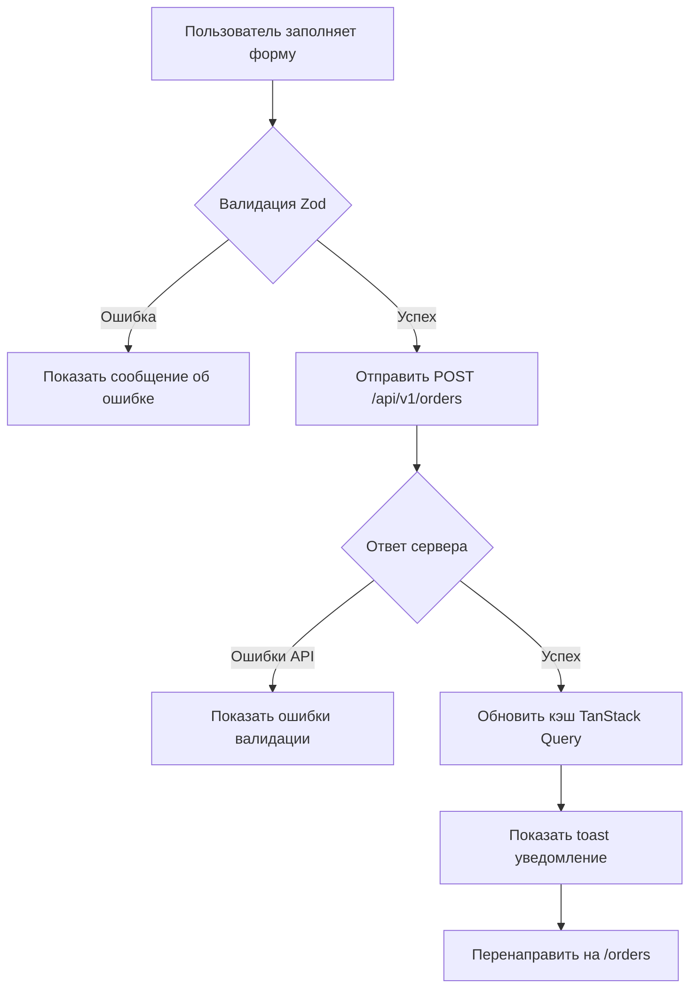

# PicNest - Модуль Бронирования и Заказов 📦

Полная документация по управлению заказами и бронированию фотостудий в проекте PicNest.

## 📦 Структура модуля

```
src/features/orders/
├── index.ts                    # Экспорт компонентов
├── BookingForm.tsx             # Форма оформления бронирования
├── OrdersList.tsx              # Список заказов
└── OrdersPage.tsx              # Страница управления заказами

src/hooks/
└── useOrders.ts                # Хуки на базе TanStack Query

src/types/
└── orders.ts                   # TypeScript типы и Zod схемы
```

## 🎯 Возможности модуля

### Оформление бронирования

- **Выбор комнаты/зала** из доступных помещений
- **Настройка времени** (дата, начало, окончание)
- **Автоматический расчет стоимости** на основе почасовой ставки
- **Контактные данные клиента** (имя, email, телефон - опционально)
- **Примечания и комментарии**

### Управление заказами

- **Отображение списка заказов** с подробной информацией
- **Фильтрация по статусам**: pending, confirmed, cancelled
- **Отмена бронирования** с подтверждением
- **Статистика** активных и завершенных заказов

### Валидация данных

- **Zod схемы** для строгих проверок входных данных
- **Валидация в реальном времени** при вводе
- **Проверка временных интервалов** (начало раньше окончания)
- **Форматирование даты и времени**

## 📋 Типы данных

### Order

```typescript
interface Order {
  id: string;
  room_id: string;
  start_time: string;    // ISO datetime или HH:mm
  end_time: string;      // ISO datetime или HH:mm
  total_price: number;
  status: 'pending' | 'confirmed' | 'cancelled';
  customer_name?: string | null;
  customer_email?: string | null;
  customer_phone?: string | null;
  notes?: string | null;
  created_at: string;
  updated_at: string;
}
```

### CreateOrderRequest

```typescript
interface CreateOrderRequest {
  room_id: string;
  start_time: string;
  end_time: string;
  total_price: number;
  customer_name?: string;
  customer_email?: string;
  customer_phone?: string;
  notes?: string;
}
```

### RoomSelection

```typescript
interface RoomSelection {
  id: string;
  name: string;
  hourly_rate?: number;     // почасовая ставка в рублях
}
```

## 🚀 Использование компонентов

### BookingForm

Компонент формы оформления бронирования.

```tsx
import { BookingForm } from './features/orders';

interface MyComponentProps {
  availableRooms: RoomSelection[];
}

const MyComponent: React.FC<MyComponentProps> = ({ availableRooms }) => {
  return (
    <BookingForm 
      availableRooms={availableRooms}
      defaultRoomId="room-1" // опционально
    />
  );
};
```

**Пропсы:**
- `availableRooms` - Список доступных комнат для бронирования
- `defaultRoomId?` - Идентификатор комнаты по умолчанию (если только одна комната)

### OrdersList

Компонент отображения списка заказов.

```tsx
import { OrdersList } from './features/orders';

<OrdersList 
  orders={orders}
  onCancelOrder={(orderId) => handleCancel(orderId)}
/>
```

**Пропсы:**
- `orders` - Массив объектов Order
- `onCancelOrder?` - Обработчик отмены заказа (обязательно для удаления)

### OrdersPage

Страница управления заказами.

```tsx
import { OrdersPage } from './features/orders';

<OrdersPage 
  availableRooms={AVAILABLE_ROOMS}
/>
```

## 📡 API Интеграция

### Хук useCreateOrder

Создание нового заказа через POST /api/v1/orders.

```tsx
import { useCreateOrder } from './hooks/useOrders';

function CreateBooking() {
  const createOrder = useCreateOrder();

  const handleCreate = async (data: CreateOrderRequest) => {
    try {
      // Валидация через Zod происходит автоматически в мутации
      const order = await createOrder.mutateAsync(data);
      
      console.log('Заказ создан:', order);
      toast.success('Бронирование успешно создано');
      
      // Перенаправление на страницу заказов
      navigate('/orders');
    } catch (error) {
      console.error('Ошибка создания заказа:', error);
    }
  };

  return <form onSubmit={handleCreate}>...</form>;
}
```

**Валидация Zod:**
- `room_id` - обязательное поле, строка
- `start_time` - обязательное поле, должно быть раньше end_time
- `end_time` - обязательное поле, должно быть позже start_time
- `total_price` - положительное число, finite
- `customer_email` - валидация email формата

### Хук useOrdersList

Загрузка списка заказов.

```tsx
import { useOrders } from './hooks/useOrders';

function OrdersDashboard() {
  const { ordersList, isLoadingOrders, errorOrders } = useOrders();

  return (
    <div>
      {isLoadingOrders && <LoadingSpinner />}
      
      {errorOrders && (
        <ErrorMessage onRetry={() => window.location.reload()} />
      )}

      {!isLoadingOrders && !errorOrders && (
        <OrdersList orders={ordersList} onCancelOrder={handleCancel} />
      )}
    </div>
  );
}
```

### Хук useRoomAvailability

Загрузка доступных слотов для комнаты.

```tsx
import { useRoomAvailability } from './hooks/useOrders';

function CheckAvailability() {
  const { data: availability, isLoading } = useRoomAvailability(
    'room-1', 
    '2024-10-25'
  );

  if (isLoading) return <div>Загрузка...</div>;

  return (
    <ul>
      {availability?.map(slot => (
        <li key={slot.id}>
          {slot.startTime} - {slot.endTime} 
          {slot.isAvailable ? ' ✓' : ' ✗'}
        </li>
      ))}
    </ul>
  );
}
```

## 🎨 Стилизация и UX

### Цветовая схема статусов заказов

| Статус | Цвет | Описание |
|--------|------|----------|
| `pending` | Желтый (bg-yellow-100) | Ожидает подтверждения |
| `confirmed` | Зеленый (bg-green-100) | Подтверждено администратором |
| `cancelled` | Красный (bg-red-100) | Отменено |

### Валидация в реальном времени

```tsx
const { formState: { errors } } = useForm<CreateOrderRequest>({
  mode: 'onChange', // Валидация при каждом изменении поля
});

// Отображение ошибок
{errors.room_id && (
  <p className="text-red-600 text-sm">{errors.room_id.message}</p>
)}
```

### Обработка состояний загрузки и ошибок

```tsx
const { createOrder, isPending, isError } = useCreateOrder();

<button 
  onClick={handleSubmit(onSubmit)}
  disabled={isPending}
>
  {isPending ? 'Отправка...' : 'Подтвердить бронирование'}
</button>
```

## 🧪 Тестирование

### Unit тесты компонентов

```tsx
import { render, screen } from '@testing-library/react';
import { BookingForm } from './BookingForm';

test('отображает форму бронирования с комнатами', () => {
  const rooms = [
    { id: 'room-1', name: 'Студия "Свет"', hourly_rate: 3000 },
    { id: 'room-2', name: 'Студия "Творчество"', hourly_rate: 4500 },
  ];

  render(<BookingForm availableRooms={rooms} />);
  
  expect(screen.getByText('Оформление бронирования')).toBeInTheDocument();
  expect(screen.getByLabelText(/комната/i)).toBeInTheDocument();
});
```

### Mock API запросов

```tsx
import { QueryClient, QueryClientProvider } from '@tanstack/react-query';
import { renderHook, waitFor } from '@testing-library/react';

const createWrapper = () => ({
  wrapper: ({ children }) => (
    <QueryClientProvider client={new QueryClient()}>
      {children}
    </QueryClientProvider>
  ),
});

test('создает заказ через useCreateOrder', async () => {
  const mockMutateAsync = jest.fn();
  const createOrderHook = { mutateAsync: mockMutateAsync };
  
  // Mock хук
  vi.mock('./hooks/useOrders', () => ({
    useCreateOrder: () => createOrderHook,
  }));

  renderHook(() => useCreateOrder(), { wrapper: createWrapper().wrapper });

  await waitFor(() => expect(mockMutateAsync).toHaveBeenCalled());
});
```

## 🔧 Расширение функциональности

### Добавление новых комнат

В App.tsx добавьте комнаты в массив AVAILABLE_ROOMS:

```tsx
const AVAILABLE_ROOMS = [
  { id: 'room-1', name: 'Студия "Свет"', hourly_rate: 3000 },
  { id: 'room-2', name: 'Студия "Творчество"', hourly_rate: 4500 },
  { id: 'room-3', name: 'Зал для мероприятий', hourly_rate: 6000 },
  // Добавьте новые комнаты здесь
];
```

### Кастомная логика расчета стоимости

Расширение хука useCreateOrder для сложной логики:

```tsx
export const useCreateOrder = () => {
  const queryClient = useQueryClient();

  return useMutation<Order, Error, CreateOrderRequest>({
    mutationFn: async (data) => {
      // Кастомная логика расчета стоимости
      const adjustedPrice = calculateAdjustedPrice(data);
      
      const response = await axios.post(`${API_BASE_URL}/orders`, {
        ...data,
        total_price: adjustedPrice,
      });
      
      return response.data;
    },
    // ... остальной код
  });
};

const calculateAdjustedPrice = (order: CreateOrderRequest): number => {
  const basePrice = order.total_price;
  
  // Скидка для длительного бронирования (> 4 часов)
  if (basePrice > 20000) {
    return Math.round(basePrice * 0.9); // 10% скидка
  }

  // Ночная ставка (после 22:00)
  const startTime = parseInt(order.start_time.substring(0, 2));
  if (startTime >= 22) {
    return Math.round(basePrice * 1.5); // +50%
  }

  return basePrice;
};
```

## 🐛 Отладка

### Проверка данных формы

```tsx
const watch = useFormState({ control });

console.log('Текущие данные формы:', watch);
```

### Инвалидация кэша вручную

```tsx
import { useQueryClient } from '@tanstack/react-query';

function RefreshOrders() {
  const queryClient = useQueryClient();
  
  const handleRefresh = () => {
    queryClient.invalidateQueries({ 
      queryKey: ORDER_KEYS.list(),
    });
  };

  return <button onClick={handleRefresh}>Обновить заказы</button>;
}
```

## 📊 Пример интеграции с бэкендом

### Настройка API URL

В `.env`:

```env
VITE_API_BASE_URL=http://localhost:8000/api/v1
```

### Обработка ошибок валидации от сервера

```tsx
const createOrder = useCreateOrder();

const onSubmit = async (data) => {
  try {
    await createOrder.mutateAsync(data);
  } catch (error) {
    const axiosError = error as AxiosError<{ 
      message?: string; 
      errors?: object 
    }>;
    
    if (axiosError.response?.data?.errors) {
      // Отображение ошибок валидации от сервера
      Object.values(axiosError.response.data.errors).forEach((fieldErrors: any[]) => {
        toast.error(fieldErrors.join(', '));
      });
    } else {
      toast.error('Ошибка при создании заказа');
    }
  }
};
```

## 📝 Чеклист для разработчиков

Перед добавлением новых функций в модуль заказов:

- [ ] Создать TypeScript интерфейсы для новых данных
- [ ] Добавить Zod схемы для валидации
- [ ] Реализовать хук с использованием TanStack Query
- [ ] Создать компоненты UI
- [ ] Добавить обработку ошибок и loading states
- [ ] Протестировать компоненты
- [ ] Обновить документацию

## 🔄 Flow diagrams

### Создание нового бронирования



### Отмена бронирования

```mermaid
graph TD
    A[Пользователь кликает "Отменить"] --> B{Подтверждение}
    B -->|Нет| C[Закрыть диалог]
    B -->|Да| D[Вызвать PATCH /api/v1/orders/{id}]
    D --> E{Ответ сервера}
    E -->|Ошибки| F[Показать ошибку]
    E -->|Успех| G[Обновить статус заказа]
    G --> H[Показать toast уведомление]
```

## 📚 Ресурсы

- [React Hook Form Documentation](https://react-hook-form.com/)
- [Zod Documentation](https://zod.dev/)
- [TanStack Query Documentation](https://tanstack.com/query/latest)
- [date-fns Documentation](https://date-fns.org/)

## 🔄 История изменений

### 2024-10-15 - Инициализация модуля
- Созданы базовые типы данных для заказов
- Реализована форма бронирования с валидацией Zod
- Добавлены хуки для работы с API через TanStack Query
- Создан компонент управления заказами

### TODO
- [ ] Интеграция со Stripe для онлайн-оплаты
- [ ] Генерация PDF-подтверждений
- [ ] Email уведомления клиентам
- [ ] Календарь бронирований (Google Calendar sync)

---

**Готово к использованию!** 🎉
